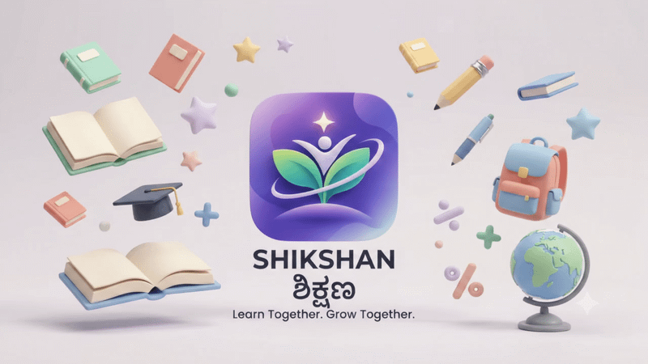
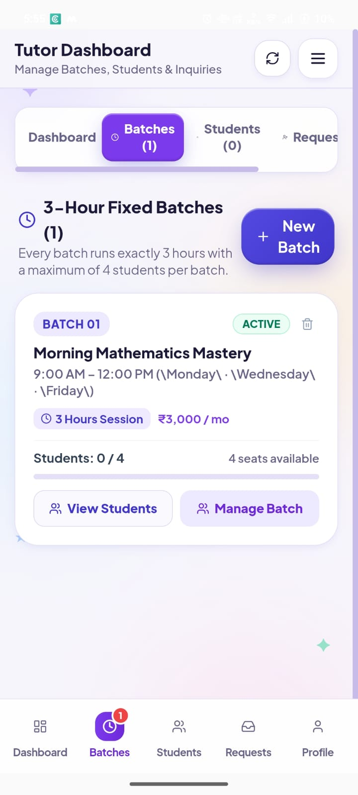
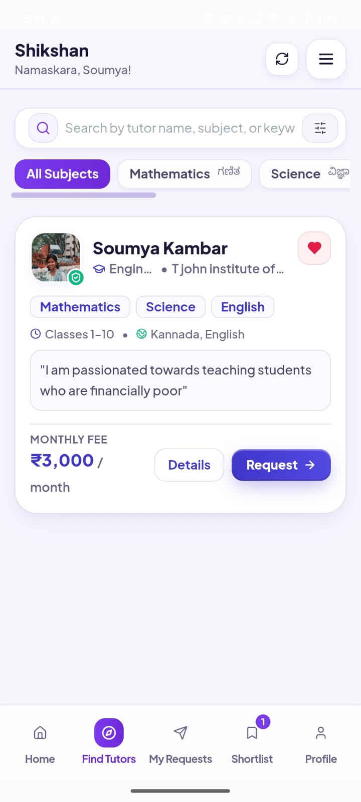
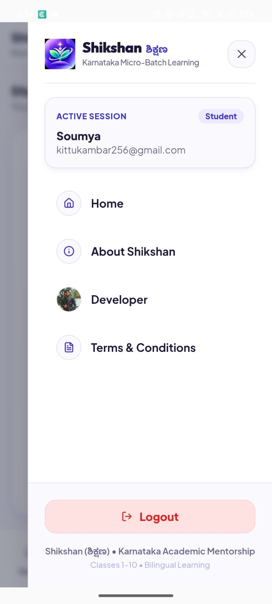
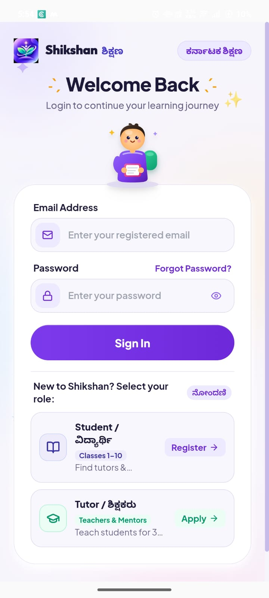
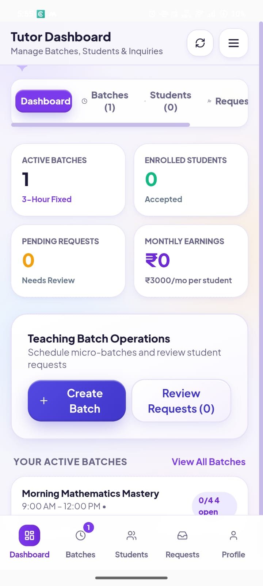
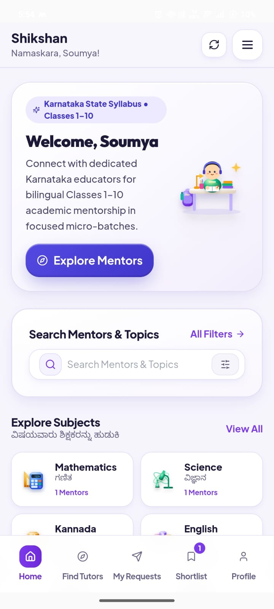
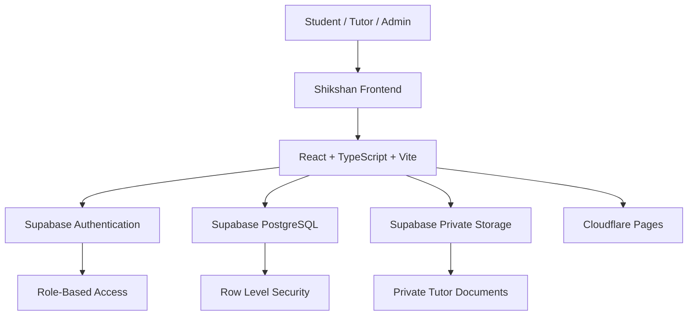

#  SHIKSHAN — ಶಿಕ್ಷಣ

<h3 align="center">Learn with confidence. Grow with guidance.</h3>

<h3 align="center">ಆತ್ಮವಿಶ್ವಾಸದಿಂದ ಕಲಿಯಿರಿ. ಮಾರ್ಗದರ್ಶನದೊಂದಿಗೆ ಮುನ್ನಡೆಯಿರಿ.</h3>

<p align="center">
  <strong>A mentor-guided learning platform for school students across Karnataka.</strong>
</p>

<p align="center">
  
  
  
  
</p>

---

## 💜 01. Welcome to Shikshan

<p align="center">
  
</p>


**Shikshan (ಶಿಕ್ಷಣ)** is an educational platform connecting school students from Classes 1–10, particularly students from rural areas and Kannada-medium schooling, with verified and dedicated tutors.

Our goal is to make structured, affordable academic guidance more accessible through continuous learning commitments rather than isolated doubt-clearing sessions.

We focus on Karnataka State Board (KSEAB/SSLC) and CBSE curricula, with bilingual learning support in Kannada and English.

<p align="center">
  <em>Every student deserves access to the right guidance, regardless of where they live.</em>
</p>

---

## 🌱 02. Our Vision & Learning Model

<!-- Shikshan animated claymorphic interlude -->

<p align="center">
  
</p>

<p align="center">
  <strong>📖 Every page brings a new possibility. Every learner deserves guidance.</strong>
</p>

<p align="center">
  
  
  
</p>

---

### Learning through long-term guidance

Shikshan is designed around structured academic commitments of:

<<table>
  <tr>
    <td align="center" width="50%">
      <h2>📘 3 Months</h2>
      <strong>Focused Learning Commitment</strong>
      <p>Consistent academic guidance over a structured learning period.</p>
    </td>
    <td align="center" width="50%">
      <h2>📚 6 Months</h2>
      <strong>Extended Learning Commitment</strong>
      <p>Longer-term support for steady conceptual understanding.</p>
    </td>
  </tr>
</table>

Our model prioritizes:

- Continuous conceptual understanding.
- Dedicated tutor–student relationships.
- Structured academic commitments.
- Small learning groups with a maximum of four students per batch.
- Curriculum-aligned explanations in Kannada and English.

**We believe learning should be consistent, personal and accessible—not limited to occasional one-hour doubt-clearing sessions.**

### Who is Shikshan built for?

| Learner group | Learning focus |
|---|---|
| Classes 1–5 | Foundational academic understanding |
| Classes 6–8 | Stronger subject concepts and learning habits |
| Classes 9–10 | Board-oriented academic preparation |
| Kannada-medium students | Bilingual explanations and curriculum support |
| Rural students | Better access to dedicated academic guidance |

---

## 🎨 03. Explore the Shikshan App

A closer look at the app's visual experience.

### Student Experience

## 📱 App Screenshots

<p align="center">
  
  
  
</p>

<p align="center">
  
  
  
</p>
---

## 🧩 04. Platform Features

<table>
  <tr>
    <td align="center" width="50%">
      <h2>🎓</h2>
      <strong>Student Portal</strong>
      <p>Discover tutors, explore subjects and submit learning requests.</p>
    </td>
    <td align="center" width="50%">
      <h2>👩‍🏫</h2>
      <strong>Tutor Portal</strong>
      <p>Manage learning batches, handle student requests and guide learners.</p>
    </td>
  </tr>
  <tr>
    <td align="center" width="50%">
      <h2>🛡️</h2>
      <strong>Administrator Portal</strong>
      <p>Review tutor applications, inspect qualifications and manage platform operations.</p>
    </td>
    <td align="center" width="50%">
      <h2>👥</h2>
      <strong>Small Learning Groups</strong>
      <p>Structured learning batches with a maximum of four students.</p>
    </td>
  </tr>
</table>

### Student-focused features

- Tutor discovery for academic subjects.
- Learning requests and request-status tracking.
- Curriculum and learning-language preferences.
- Parent/guardian consent considerations for minors.
- Access to tutor information according to request approval.

### Tutor-focused features

- Tutor onboarding and application submission.
- Academic qualification and marksheet submission.
- Tutor application status tracking.
- Batch creation and management.
- Student request management.

### Administrator features

- Centralized tutor application review desk.
- Academic marksheet inspection.
- Tutor approval, rejection and information requests.
- Confidential internal review notes.
- User and application management.

---

## 🛡️ 05. Tutor Verification & Trust

Trust is an important part of Shikshan.

### Human-led verification

Shikshan does not use automated tutor quizzes or in-app assessment examinations.

Instead, tutor applications are manually reviewed by the founder and trusted educators based on:

- Academic marksheets.
- Educational qualifications.
- Submitted application details.
- Relevant subject knowledge and academic background.

### Application review states

| Status | Meaning |
|---|---|
| `pending_review` | Application is awaiting review |
| `approved` | Application has been explicitly approved |
| `rejected` | Application has been rejected |
| `needs_info` | Additional information is required |

<badge color="success">Verification principle</badge>

A tutor must never be represented as approved or verified until the review team has explicitly approved the application.

---

## 👨‍👩‍👧 06. Child Privacy & Safety

Shikshan is designed for school students, including minors. Privacy and responsible data handling are important considerations.

### Data minimization

The platform aims to collect only information necessary for its educational purpose.

It does not require unnecessary demographic information such as:

- Caste.
- Religion.
- Marital status.
- Full residential address.

### Parent/guardian consent

Parent or guardian consent is considered as part of the student onboarding and minor-safety process.

### Private academic documents

Tutor academic marksheets are stored in a private Supabase Storage bucket.

Security measures specified for this system include:

- Private storage rather than public document links.
- Row Level Security (RLS).
- User-isolated document folders.
- Time-limited signed URLs for authorized reviewers.
- Restricted document access.

### Privacy principles

- Collect minimal personal information.
- Restrict access according to user roles.
- Protect academic documents.
- Avoid exposing private tutor or student information unnecessarily.
- Support appropriate account and document deletion requests.

---

## 🏗️ 07. Technical Architecture

Shikshan uses a modern web application stack with a mobile-first, responsive interface.

### Technology stack

| Layer | Technology |
|---|---|
| Frontend | React 18 |
| Programming language | TypeScript |
| Build tool | Vite |
| Routing | React Router v6 |
| Styling | Custom Modern Claymorphism Design System |
| Icons | lucide-react |
| Authentication | Supabase Auth |
| Database | Supabase PostgreSQL |
| Database security | Row Level Security (RLS) |
| Document storage | Supabase Storage |
| Hosting | Cloudflare Pages |
| SPA routing | Cloudflare Pages `_redirects` |
| Testing | Vitest |
| Component testing | React Testing Library |
| DOM matchers | @testing-library/jest-dom |

### Architecture overview



### Design system

Shikshan follows a custom claymorphic visual direction:

- Soft rounded surfaces.
- Tactile dimensional shadows.
- Subtle depth and highlights.
- Accessible high-contrast navy typography.
- Responsive mobile-first layouts.
- Consistent spacing and visual hierarchy.

### Brand colour palette

<p align="center">
  
  
  
  
</p>

---

## 🚀 08. Quick Start & Local Development

### Prerequisites

- Node.js v18+ or v20+ (tested on Node v24).
- npm v9+ or v11+.
- Git.

### Step 1 — Clone the repository

```bash
git clone YOUR_REPOSITORY_URL
cd shikshan
```

### Step 2 — Install dependencies

```bash
npm install
```

### Step 3 — Configure environment variables

Copy `.env.example` to `.env`.

```bash
cp .env.example .env
```

Add your Supabase project credentials:

```env
VITE_SUPABASE_URL=https://your-project.supabase.co
VITE_SUPABASE_ANON_KEY=your-actual-anon-key
VITE_SITE_URL=http://localhost:5173
```

Replace the example values with your actual project credentials.

**Important:** Never commit real secrets or private service-role keys to GitHub. The Supabase anon/publishable key is intended for client-side use with correctly configured database and storage security policies.

If credentials have not yet been supplied, the project specification describes a safe demo/preview mode with a setup banner.

### Step 4 — Start the development server

```bash
npm run dev
```

Open:

```text
http://localhost:5173
```

### Step 5 — Run automated tests

```bash
npm test
```

### Step 6 — Build for production

```bash
npm run build
```

---

## 🗄️ 09. Supabase Setup & Database Deployment

Shikshan uses Supabase Authentication, PostgreSQL and private Storage according to this project architecture.

### A. Create a Supabase project

1. Visit [Supabase](https://supabase.com/).
2. Create a new project.
3. Open **Settings → API**.
4. Note the Project URL and anon public key.
5. Add them to your local `.env` file.

### B. Execute the database migration

Open the Supabase SQL Editor and run:

```text
supabase/schema.sql
```

The schema creates the following tables:

| Table | Purpose |
|---|---|
| `profiles` | User profiles linked to `auth.users(id)` and roles |
| `tutor_applications` | Tutor application details and review status |
| `student_profiles` | Student academic and guardian-consent information |
| `tutor_documents` | Academic marksheet document records |
| `admin_review_history` | Confidential internal review audit trail |

### Database security

The schema enables Row Level Security on all tables.

The specified security rules include:

- Ordinary tutors cannot approve their own applications.
- Students cannot access private tutor dossiers.
- User access is controlled through database policies.
- Administrative review information remains confidential.

### C. Configure private document storage

Open the Supabase SQL Editor and run:

```text
supabase/storage.sql
```

This configures the private storage bucket:

```text
tutor-documents
```

Specified storage configuration:

| Setting | Configuration |
|---|---|
| Bucket visibility | Private |
| Maximum file size | 5 MB |
| Accepted formats | PDF, JPG, PNG |
| Folder isolation | `<user_id>/<file>` |
| Applicant access | Own documents |
| Reviewer access | Authorized administrators |

Document access uses signed URLs with limited validity rather than permanent public links.

### D. Promote the founder to administrator

1. Sign up in the application using the administrator email.
2. Open the Supabase SQL Editor.
3. Execute the administrator seed script:

```text
supabase/seed_admin.sql
```

The supplied script is:

```sql
UPDATE public.profiles
SET role = 'admin'
WHERE email = 'founder@shikshan.org';
```

Replace the example email with the actual administrator email before execution if required by your deployment.

### E. Configure Supabase Auth email and redirects

Navigate to:

**Supabase Dashboard → Authentication → URL Configuration**

Configure the production Site URL:

```text
https://your-domain.pages.dev
```

Add the required redirect URLs:

```text
http://localhost:5173/**
https://your-domain.pages.dev/**
https://your-domain.pages.dev/update-password
```

Replace `your-domain` with your actual production domain.

---

## ☁️ 10. Cloudflare Pages Deployment

Shikshan's frontend is configured for static hosting on Cloudflare Pages.

### Option 1 — Git integration (recommended)

1. Push the repository to GitHub or GitLab.
2. Open the [Cloudflare Dashboard](https://dash.cloudflare.com/).
3. Navigate to **Workers & Pages**.
4. Select **Create application → Pages → Connect to Git**.
5. Select your Shikshan repository.

Configure the build settings:

| Setting | Value |
|---|---|
| Framework preset | Vite |
| Build command | `npm run build` |
| Build output directory | `dist` |

Configure the required environment variables in Cloudflare Pages:

```env
VITE_SUPABASE_URL=https://your-project.supabase.co
VITE_SUPABASE_ANON_KEY=your-anon-key
VITE_SITE_URL=https://your-domain.pages.dev
```

Save and deploy.

### Option 2 — Wrangler CLI deployment

Build the application:

```bash
npm run build
```

Deploy the generated `dist` directory:

```bash
npx wrangler pages deploy dist --project-name shikshan
```

### SPA routing support

The project includes:

```text
public/_redirects
```

This file is intended to support client-side routes such as:

```text
/tutor/status
/student/dashboard
/admin
```

It allows nested routes to load correctly after direct navigation or browser refresh.

---

## 🧑‍💼 11. Founder Administration & Tutor Reviews

Shikshan includes an in-app administrator review desk.

### Administrator review desk

Access:

```text
/admin
```

The administrator review desk is intended for authenticated users with the `admin` role.

### Pending application queue

Administrators can view tutor applications awaiting qualification checks.

### Academic marksheet inspection

The administrator can select **Inspect** next to an uploaded marksheet.

The specified workflow:

1. Request a signed document URL.
2. Generate a time-limited URL valid for five minutes.
3. Open the document for authorized review.
4. Avoid exposing permanent public document links.

### Application decision controls

| Action | Result |
|---|---|
| Approve Tutor | Changes application status to `approved` |
| Request More Info | Changes status to `needs_info` |
| Reject Application | Changes status to `rejected` |

Administrators can also add confidential internal review notes.

These notes are stored in:

```text
admin_review_history
```

They are intended to remain concealed from applicants.

### Supabase Dashboard fallback

Administrators can also manage records through the Supabase Dashboard.

| Task | Supabase location |
|---|---|
| Registered users | Authentication → Users |
| Tutor applications | Table Editor → `tutor_applications` |
| Academic marksheets | Storage → `tutor-documents` |
| Student profiles | Table Editor → `student_profiles` |

---

## 🔐 12. Account Deletion & Right to Be Forgotten

Shikshan recognizes that users may request account deletion.

The specified deletion workflow includes:

### Step 1 — Delete the authentication user

Navigate to:

```text
Supabase Dashboard → Authentication → Users
```

Delete the requested user.

The supplied database design uses foreign-key relationships with `ON DELETE CASCADE` for related records such as:

- `profiles`
- `student_profiles`
- `tutor_applications`

### Step 2 — Remove stored academic documents

Navigate to:

```text
Storage → tutor-documents
```

Locate the user's folder:

```text
tutor-documents/<user_id>/
```

Delete the user's stored marksheet files to prevent orphaned personal documents.

**Important:** Account deletion should be verified across database records, authentication and storage. Storage objects should not be assumed to disappear automatically when an authentication user is deleted.

---

## 🧪 13. Automated Testing

Shikshan uses:

- Vitest.
- React Testing Library.
- `@testing-library/jest-dom`.

Run the test suite:

```bash
npm test
```

### Supplied test results

<badge color="success">13 tests passed</badge> <badge color="success">5 test files</badge>

| Test file | Coverage | Tests |
|---|---|---:|
| `src/test/navigation.test.tsx` | Brand name, tagline, welcome message, role buttons, hamburger drawer and nested back navigation | 3 |
| `src/test/auth.test.tsx` | Email/password validation, login errors and password reset | 2 |
| `src/test/tutor-flow.test.tsx` | Five-step onboarding, validation, back-navigation preservation and commitment model | 3 |
| `src/test/student-flow.test.tsx` | Minor considerations, guardian consent, Karnataka State Board and Kannada learning options | 3 |
| `src/test/admin.test.tsx` | Protected review desk, application queue, approval actions and confidential notes | 2 |
| **Total** | **5 test files** | **13** |

<p align="center">
  
  
</p>

*These are the test results supplied in the project documentation. Run `npm test` on the current repository to confirm the present results.*

---

## 🗺️ 14. Future Direction

Shikshan's long-term direction is to improve the accessibility and quality of academic guidance.

Areas of continued development include:

- Smarter student–tutor recommendations.
- Better batch management and learning coordination.
- A smoother mobile-first experience.
- Continued improvements to privacy and security.
- More accessible bilingual learning experiences.
- Better tools for tutors and administrators.

---

## 💜 15. The Idea Behind Shikshan

Shikshan is built around a simple belief:

**A student's opportunity to learn should not be limited by their location, language or access to traditional tuition.**

We want to connect passionate tutors with students who need guidance and build an environment that encourages consistent learning, trust and academic growth.

<p align="center">
  
</p>

<h2 align="center">SHIKSHAN — ಶಿಕ್ಷಣ</h2>

<h3 align="center">Learn with confidence. Grow with guidance.</h3>

<h3 align="center">ಆತ್ಮವಿಶ್ವಾಸದಿಂದ ಕಲಿಯಿರಿ. ಮಾರ್ಗದರ್ಶನದೊಂದಿಗೆ ಮುನ್ನಡೆಯಿರಿ.</h3>

<p align="center">
  <strong>Built with purpose. Inspired by learning. Designed for growth.</strong>
</p>

<p align="center">
  ⭐ If you believe in the vision of Shikshan, consider giving this project a star!
</p>
